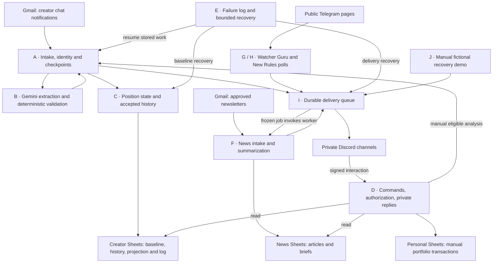
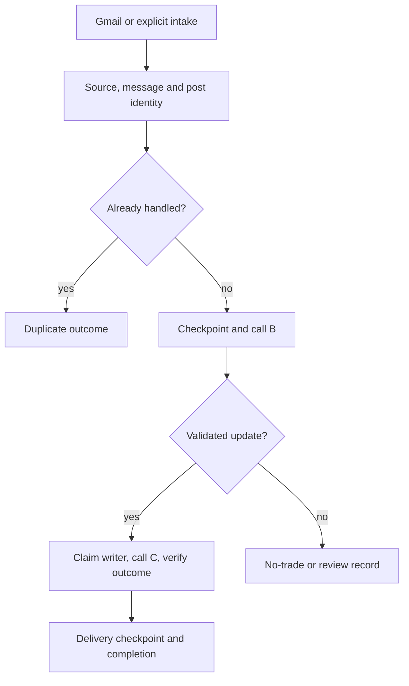
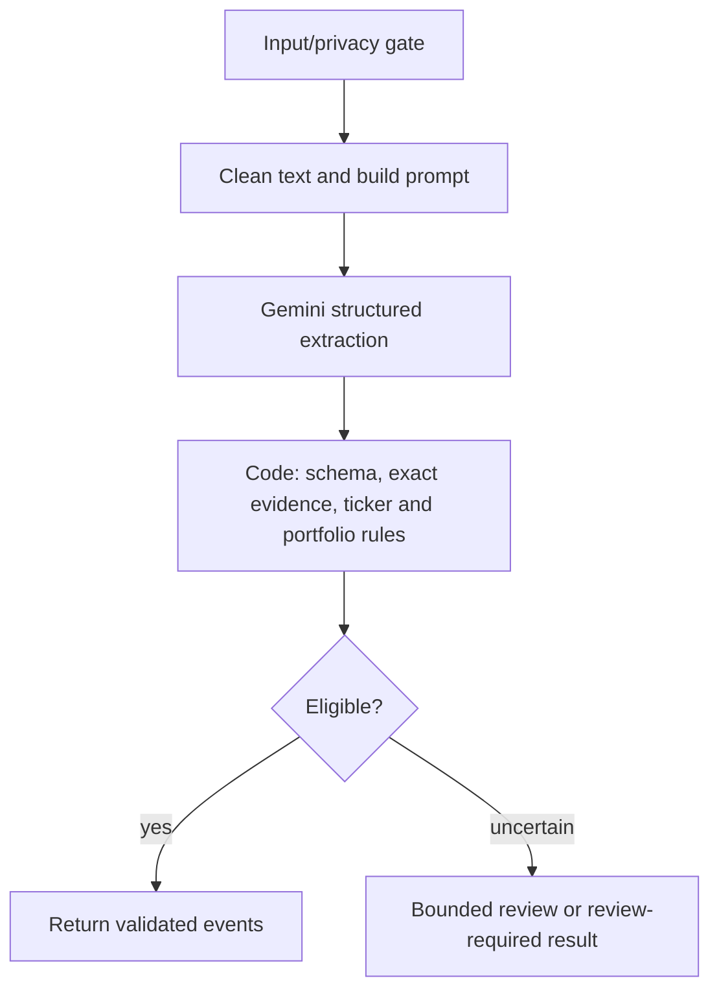
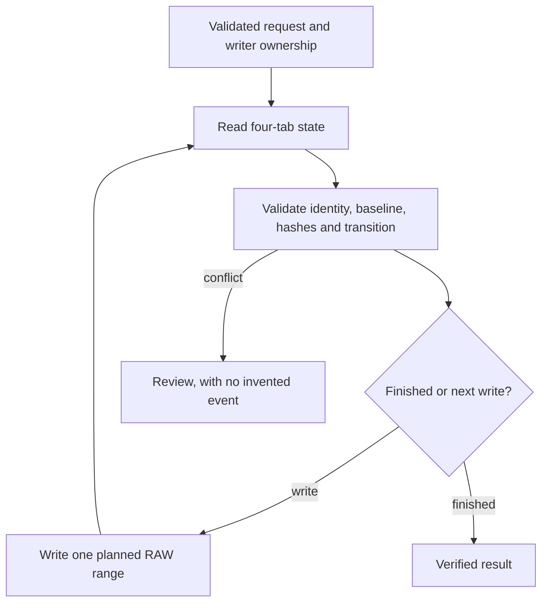
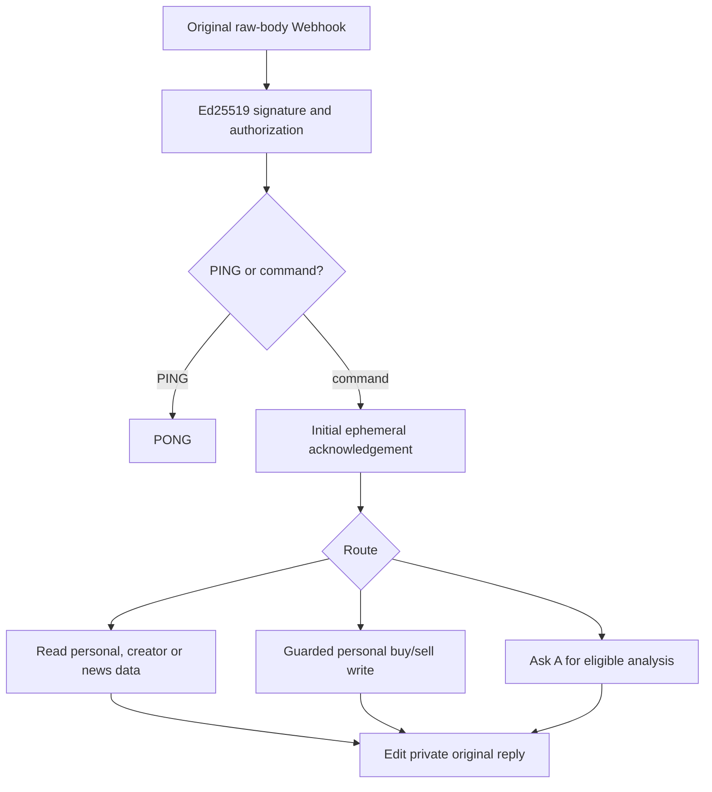
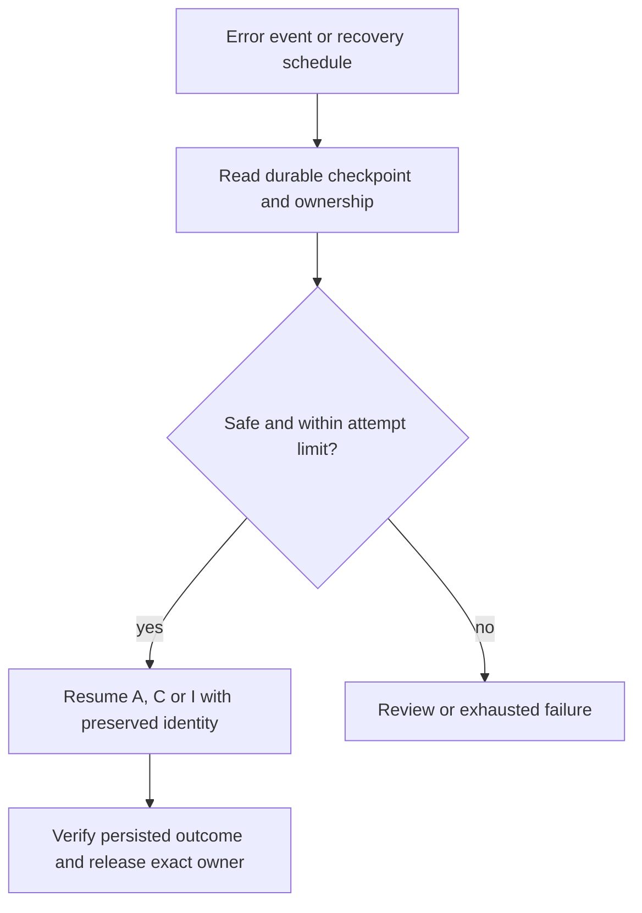
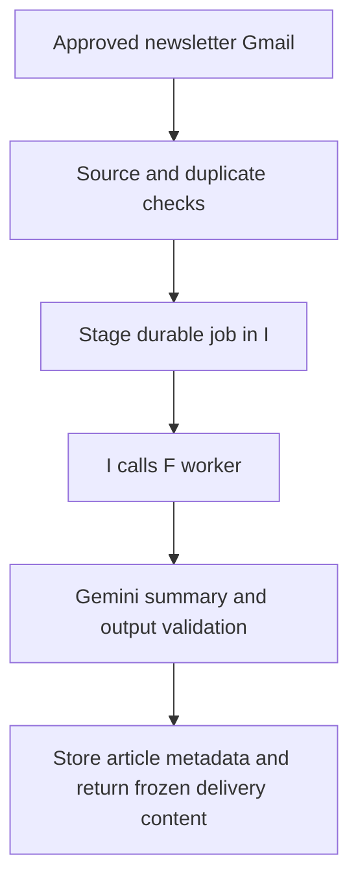
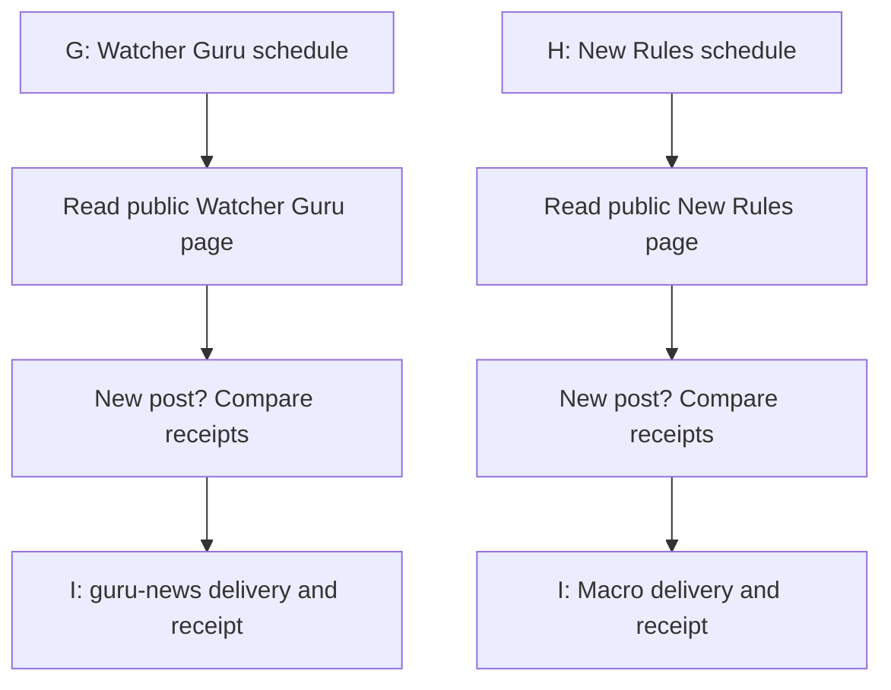
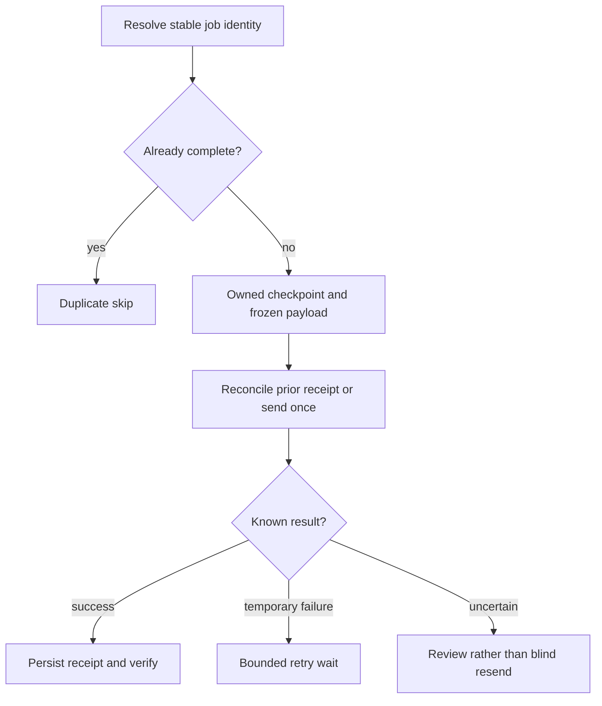
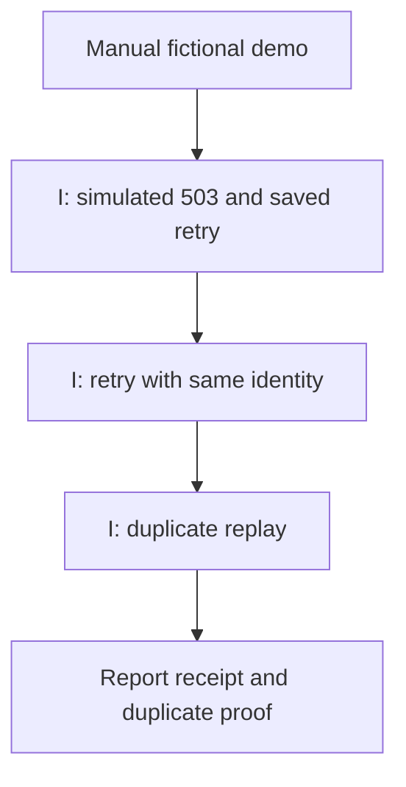

# Architecture and workflow reference

Captured 22 October 2026. Names and node lists are indexed in [node-inventory.json](node-inventory.json); source versions are recorded in [the manifest](../config/export-manifest.json). The ten workflows are preserved, not rebuilt for this repository.

## Overall system

Failures from configured workflows enter E through n8n's Error Trigger. E's schedule also checks unfinished work. Arrows into Sheets represent the logical data stores; implementation uses Google APIs via authenticated HTTP Request nodes, not necessarily a node named Google Sheets. Gmail, Gemini, Sheets and Discord all remain external services after self-hosting.

## Workflow map

| Workflow | Start method | Responsibility | Result |
| --- | --- | --- | --- |
| A Email Processor | Gmail trigger every five minutes; sub-workflow call; manual regression branches | Verify source, normalize chat, deduplicate message/post, freeze analysis, coordinate B/C and guarded notifications | Accepted position update, no-trade, review, duplicate or retry checkpoint |
| B AI Analyzer | Execute Workflow Trigger; manual test branches | Gemini extraction, strict structure/evidence/portfolio checks, bounded secondary review | Structured candidate events and deterministic eligibility result |
| C Position Manager | Execute Workflow Trigger; manual tests | Validate transitions, preserve baseline and append-only accepted trades, rebuild projections, verify writes | Reconciled state or explicit review/error; never invent missing baseline trades |
| D Discord Handler | Signed Webhook; manual tests/admin branches | Verify original request bytes and Discord signature, guild/user authorization, immediate acknowledgement, route commands | Private ephemeral replies; authorized personal changes written to Sheets |
| E Error & Recovery | Error Trigger, schedule, sub-workflow call, manual tests | Sanitize failures, bound attempts, inspect ownership/checkpoints, resume unfinished work | Retry, recovered completion or manual review |
| F Market Intelligence | Gmail trigger, worker sub-workflow, manual fixture | Normalize approved newsletters, classify/summarize with Gemini, persist article/brief, supply delivery payload | Stored news and private news delivery through I |
| G Watcher Guru | Five-minute schedule; manual real-source probe | Poll public page, deduplicate posts, queue original text | I delivers to configured private guru-news channel |
| H New Rules Macro | Five-minute schedule; manual real-source probe | Poll public page, deduplicate posts, queue original text | I delivers to configured private Macro channel |
| I Durable Delivery | Execute Workflow Trigger; manual operator branches | Queue identity, ownership, frozen payload, retry limit, Discord receipt reconciliation, attachments | Delivered receipt, retry wait or review |
| J Recovery Demo | Manual Trigger only | Inject a fictional transient 503 in I's demonstration path, retry, replay duplicate | Demonstration evidence; it can send one fictional bot-errors message if executed live |

**Manual** means a person initiates that entry point. It does not mean all connected nodes are harmless or simulated. G/H manual probes read real pages; J may send a message; some D branches administer commands. Use the offline test runner for no-side-effect checks.

## Simplified workflow diagrams

### A — coordinate intake

### B — extraction versus permission to write

AI interprets natural language. Code checks required keys/types, allowed actions, evidence substrings, source rules, portfolio aliases and ticker syntax. C then decides whether historical state permits an update. No exchange/security-master API validates symbol existence. Dick's approved shorthand policy is source-specific; it is not a rule for every newsletter.

### C — durable state transition

### D — interaction routing

### E — recovery coordination

### F — newsletter briefs

### G and H — separate relay workflows

These are polling relays of publicly accessible pages, not a Telegram account session or a guaranteed complete Telegram stream. Page changes, deleted posts and polling windows can create gaps.

### I — delivery recovery

### J — repeatable demonstration

E is the scheduler/coordinator for recovery. I contains the durable delivery state machine. J is the demonstration caller that exercises I; it is not the production scheduler and its 503 is deliberately simulated.

